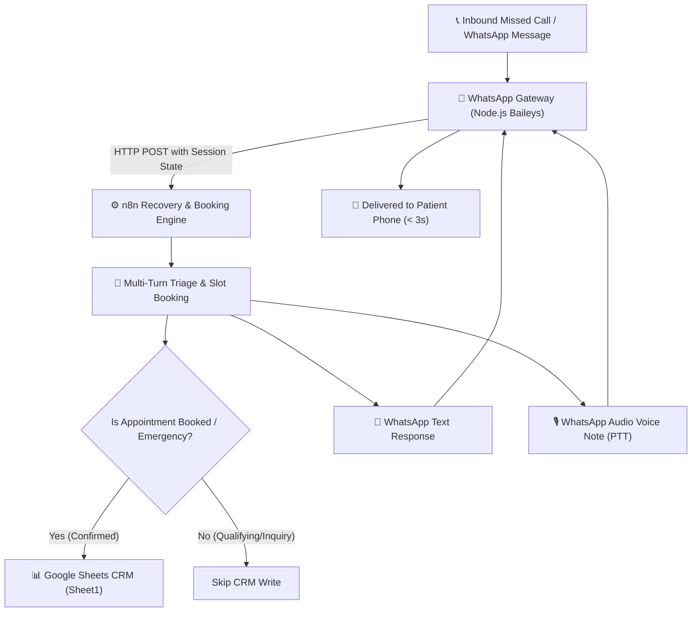

# ⚡ Day 02: Sub-60s Missed-Call Auto-Recovery & Conversational AI Booking Engine

> **Autonomous clinic pipeline recovering lost revenue from missed patient calls using WhatsApp, n8n, multi-turn conversational booking, and voice note audio replies.**

---

## 💼 The Problem & ROI
* **62% of inbound phone calls** to small dental & healthcare practices go unanswered due to busy front desks or after-hours inquiries.
* **85% of callers** who fail to reach a human call a competitor clinic within 15 minutes.
* **Average Patient Lifetime Value (LTV):** $1,200 – $4,500. A single missed emergency patient represents thousands in lost revenue.

---

## 🚀 Key Features

### 1. Multi-Turn Conversational Memory
* Never repeats robotic greetings. Remembers the ongoing dialogue and context across multiple WhatsApp messages.
* Qualifies patients step-by-step: greeting → emergency triage vs. routine inquiry → slot selection (morning/afternoon) → booking confirmation.

### 2. Verified Google Sheets Gatekeeper
* **Strict Conditional Sync:** Patient data is **only** written to Google Sheets once an appointment is officially booked and confirmed (or flagged as an urgent medical emergency).
* Initial greetings or general questions do not pollute the CRM database with duplicate rows.

### 3. Voice Note (Audio) & Waveform Replies
* Speaks back to patients using native WhatsApp voice notes (`ptt: true`) alongside concise text messages.
* Delivers empathetic clinical guidance powered by lightweight, zero-dependency text-to-speech.

### 4. Smart Call Interceptor
* Intercepts incoming WhatsApp voice calls on the business number.
* Automatically triggers the sub-60s recovery text and audio response:
  *"Hi! I see you just tried calling Apex Dental Clinic. We're currently assisting another patient, but I'm Sarah, your 24/7 AI Receptionist! I can book your appointment right here in 30 seconds."*

---

## 🏗️ Architecture



---

## 🛠️ Tech Stack
* **Orchestration:** `n8n` (Self-hosted on Cloud VPS)
* **WhatsApp Gateway:** Node.js (`@whiskeysockets/baileys` WebSocket bridge)
* **Voice & Audio:** Google Speech Synthesizer (Zero-dependency TTS)
* **Database / CRM:** Google Sheets API (via GCP Service Account `AqyKDLuwANoDYrEw`)

---

## 🚀 Quickstart & Testing

### 1. Start the Gateway
```bash
cd gateway
npm start
```
Scan the displayed QR code with your phone (**WhatsApp > Settings > Linked Devices > Link a Device**).

### 2. Conversational Flow Test
1. Send `HI` -> Bot asks if you need emergency care or routine checkup, and asks for morning/afternoon. *(Google Sheet is NOT touched)*.
2. Reply `morning` -> Bot confirms your appointment for Tomorrow Morning at 10:00 AM with Dr. Sarah. *(Google Sheet logs the confirmed booking instantly!)*.
3. Bot sends both text and a WhatsApp voice note audio message with waveform.

---

## 👤 Author
**Muhammad Rehan**  
Founder & Voice AI Specialist  
* **LinkedIn:** [linkedin.com/in/rehan-zia-voiceai](https://www.linkedin.com/in/rehan-zia-voiceai/)  
* **GitHub:** [rehanziadeveloper-ship-it](https://github.com/rehanziadeveloper-ship-it)
