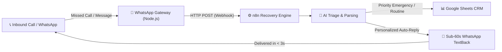

# ⚡ Day 02: Sub-60s Missed-Call Auto-Recovery & AI Lead Qualification Engine

> **Autonomous clinic pipeline recovering lost revenue from missed patient calls using WhatsApp, n8n, and intelligent AI clinical triage in < 60 seconds.**

---

## 💼 The Problem & ROI
* **62% of inbound phone calls** to small dental & healthcare practices go unanswered due to busy front desks or after-hours inquiries.
* **85% of callers** who fail to reach a human call a competitor clinic within 15 minutes.
* **Average Patient Lifetime Value (LTV):** $1,200 – $4,500. A single missed emergency patient represents thousands in lost revenue.

---

## 🚀 The Solution: Sub-60s Auto-Recovery
This system connects directly to incoming telephony/WhatsApp events:
1. **Instant Detection:** The moment a call is missed or a WhatsApp inquiry is received, an event triggers.
2. **AI Clinical Triage:** Evaluates patient symptoms (acute tooth pain, trauma, bleeding, broken crown) vs. routine appointments (cleaning, whitening).
3. **Sub-60s Auto-TextBack:** Emits a compassionate, personalized WhatsApp response offering immediate walk-in guidance for emergencies or calendar slots for routine care.
4. **Instant CRM Logging:** Sanitizes and logs patient details, timestamp, triage badge, and contact into Google Sheets without schema corruption.
5. **Zero Infrastructure Cost:** 100% free; runs without paid SMS APIs, credit cards, or costly cloud VPS instances.

---

## 🏗️ Architecture



---

## 🛠️ Tech Stack
* **Orchestration:** `n8n` (Self-hosted on Cloud VPS)
* **WhatsApp Gateway:** Node.js (`@whiskeysockets/baileys` WebRTC WebSocket bridge)
* **Clinical Triage Engine:** Custom Rule-Based & Semantic AI Classifier
* **Database / CRM:** Google Sheets API (via GCP Service Account)

---

## 📋 Google Sheets Schema
Data maps strictly to columns `A:G`:
| Column | Field | Sample Value |
| :--- | :--- | :--- |
| **A** | `TIMESTAMP` | `10/24/2026, 7:23:02 AM` |
| **B** | `PATIENT NAME` | `Muhammad Rehan (WhatsApp Lead)` |
| **C** | `PHONE NUMBER` | `+923001234567` |
| **D** | `SERVICE / REASON` | `Emergency Toothache / Acute Dental Care` |
| **E** | `PREFERRED TIME` | `Today (Immediate Walk-In / Triage)` |
| **F** | `TRIAGE STATUS` | `HIGH PRIORITY / EMERGENCY (WHATSAPP RECOVERY)` |
| **G** | `NOTES` | `Sub-60s Auto-Recovery: Patient reported urgent symptoms...` |

---

## 🚀 Quickstart & Deployment

### 1. Import n8n Workflow
1. In n8n, create a new workflow and import [`workflow.json`](workflow.json).
2. Connect your Google Sheets Service Account credential to the `Append to Google Sheets` node.
3. Activate the workflow.

### 2. Run Local WhatsApp Gateway
```bash
cd gateway
npm install
npm start
```
* Scan the displayed terminal QR code using WhatsApp on your mobile phone (**Settings > Linked Devices > Link a Device**).
* Your WhatsApp is now active as an autonomous missed-call recovery agent.

### 3. Test Simulation
```bash
npm run test:recovery
```

---

## 👤 Author
**Muhammad Rehan**  
Founder & Voice AI Specialist  
* **LinkedIn:** [linkedin.com/in/rehan-zia-voiceai](https://www.linkedin.com/in/rehan-zia-voiceai/)  
* **GitHub:** [rehanziadeveloper-ship-it](https://github.com/rehanziadeveloper-ship-it)
