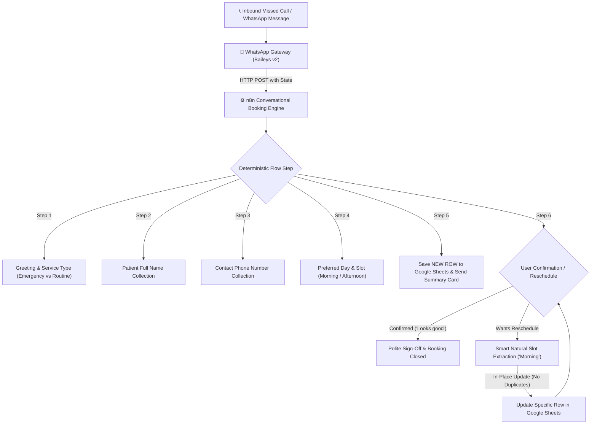

# ⚡ Day 02: Apex Dental AI Receptionist & Sub-60s Missed-Call Auto-Recovery

> **Autonomous multi-turn WhatsApp clinical receptionist and sub-60s missed-call recovery engine for dental clinics. Built with Node.js (Baileys), n8n, deterministic state machine architecture, and real-time Google Sheets CRM synchronization with in-place reschedule deduplication.**

---

## 💼 The Problem & Clinic ROI
* **62% of inbound calls** to dental clinics go unanswered during peak hours or after-hours.
* **85% of callers** who reach voicemail call a competitor clinic within 15 minutes.
* **Average Patient Lifetime Value (LTV):** $1,200 – $4,500. A single recovered dental patient covers the entire automation stack.

---

## 🎯 Architecture & Standard 6-Step Clinical Flow

The receptionist follows a strict, deterministic 6-step conversational state machine designed for high clinical conversion and zero patient friction:



---

## 🛡️ Strict Conversation Rules

1. **One Question at a Time:** The bot NEVER asks more than one question per message, waiting for patient input before advancing.
2. **Never Repeat Yourself:** Dynamic clarification handlers automatically rephrase questions if input is ambiguous or needs clarification.
3. **Off-Topic Deflection:** Unrelated chatter is politely redirected back to booking (*"I'd be happy to help with that later, but first, let's get your appointment scheduled..."*).
4. **Scannable Formatting:** Dense paragraph blocks are strictly forbidden. All summaries and triage notices use clean line breaks and bullet points.
5. **Dynamic Fee Quoting & Sheets Privacy:**
   - Consultation fee inquiries quote standard `$50–$100 depending on the case` (with transparent zero-surcharge emergency pricing).
   - Quoted fee is included in the summary card **only** if the patient asked about fees.
   - Fee data is **never** sent to Google Sheets (clinical privacy compliance).
6. **In-Place Reschedule Deduplication:**
   - Phone numbers are normalized to match Google Sheets numeric cells (`3471098310`).
   - Rescheduled slots update the patient's existing row in place without duplicating records.
7. **Clean Clinical Status:**
   - Triage column records strictly: `Emergency Case` or `Standard`.

---

## 📋 Exact Summary Card Format

When an appointment is collected or rescheduled, the patient receives this exact bulleted summary card:

```text
Great, I have your details. Here is the summary of your appointment:
- Name: Rehan Zia
- Phone: 03471098310
- Service: Emergency
- Date & Time: Morning
- Estimated Fee: $50-$100   <-- (Included ONLY if asked)

Does this look correct, or do you need to change the date and time?
```

Upon confirmation:
> *"Perfect, your appointment is booked. We look forward to seeing you at Apex Dental Clinic!"*

---

## 🛠️ Tech Stack & Components

| Component | Technology | Purpose |
| :--- | :--- | :--- |
| **Workflow Engine** | `n8n` (Self-Hosted Cloud VPS) | Multi-turn clinical state machine, qualification, and data orchestration. |
| **WhatsApp Gateway** | Node.js (`@whiskeysockets/baileys`) | Multi-device WebSocket connection, session caching, and sub-60s call interception. |
| **Database / CRM** | Google Sheets API v4 (Service Account) | Real-time clinical lead log, status triage, and in-place upsert. |
| **Call Interceptor** | Baileys `sock.ev.on('call')` | Intercepts voice calls to trigger auto-text recovery within 30 seconds. |

---

## 📊 Google Sheets Data Schema (`Sheet1`)

| Column | Header | Description | Example |
| :--- | :--- | :--- | :--- |
| **A** | `TIMESTAMP` | ISO / Locale timestamp of booking | `10/24/2026, 2:05:18 PM` |
| **B** | `PATIENT NAME` | Full patient name | `Rehan Zia` |
| **C** | `PHONE NUMBER` | Normalized matching key | `3471098310` |
| **D** | `SERVICE / REASON` | Service category | `Emergency` / `Routine` |
| **E** | `PREFERRED TIME` | Clean day / slot | `Morning` / `Thursday 4:00 PM` |
| **F** | `TRIAGE STATUS` | Clinic priority | `Emergency Case` / `Standard` |
| **G** | `NOTES` | Operational tags | `Emergency Case - Apex Dental Clinic` |

---

## 🚀 Local Gateway Setup & Testing

### 1. Install & Start Gateway
```bash
cd gateway
npm install
npm start
```

### 2. Connect WhatsApp
Scan the generated QR code in your terminal:
> **WhatsApp > Settings (or 3 dots) > Linked Devices > Link a Device**

### 3. Verify Sub-60s Missed-Call Auto-Recovery
1. Call the WhatsApp business number from another phone: The gateway rejects the call and instantly texts back:
   > *"Hello! I am the receptionist for Apex Dental Clinic. Are you looking for an emergency visit or a normal routine check-up?"*
2. Provide your name, phone number, and preferred slot.
3. Test reschedule: Reply *"Yeah I will change it into morning"* — verify that the slot updates to `Morning` and updates your existing row in Google Sheets in place without creating a duplicate row!

---

## 👤 Author
**Muhammad Rehan**  
Automation Developer & Voice AI Specialist  
* **LinkedIn:** [linkedin.com/in/rehan-zia-voiceai](https://www.linkedin.com/in/rehan-zia-voiceai/)  
* **GitHub:** [rehanziadeveloper-ship-it](https://github.com/rehanziadeveloper-ship-it)
