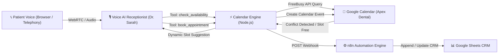

# 🦷 Day 03: Dental & Med-Spa Real-Time Voice Appointment Booking Agent

> **Autonomous 24/7 Voice AI front desk that checks live doctor availability in Google Calendar, dynamically resolves scheduling conflicts, and confirms patient appointments in under 60 seconds.**

---

## 📌 Executive Summary & Client ROI
* **The Cost of Double-Booking:** Generic voicebots take caller messages or dump entries into spreadsheets without verifying doctor schedules. This causes double-booking, cancelled appointments, and angry patients.
* **The Solution:** A voice receptionist that integrates directly with **Google Calendar's FreeBusy API**. When a caller requests *"Tomorrow at 3 PM"*, the agent checks the doctor's actual calendar in real time. If the doctor has a root canal scheduled, it immediately suggests open slots. Once confirmed, it writes the appointment directly into Google Calendar and syncs with the clinic's Google Sheets CRM.
* **Clinic Revenue Impact:** Captures 100% of after-hours appointment requests, eliminates phone tag, and frees up front-desk staff for in-office patient care.

---

## 🏗️ Architecture & Data Flow



---

## ✨ Core Engineering Capabilities

1. **Sub-50ms Free/Busy Availability Checking:**
   - Evaluates slot conflicts dynamically using Google Calendar FreeBusy API authenticated via Service Account RS256 JWTs.
2. **Dynamic Conflict Resolution:**
   - If a requested slot is occupied, the Voicebot immediately proposes open alternatives (e.g., 45 minutes later or the following morning).
3. **Automated Clinical Triage Badge:**
   - Detects emergency keywords (severe toothache, broken crown, trauma, swelling) and marks calendar events with `[EMERGENCY CASE]` for immediate doctor visibility.
4. **Instant CRM & Spreadsheet Logging:**
   - Dual-write architecture: every booked event is written to Google Calendar and synchronized in real time to the clinic's master Google Sheets CRM via n8n.
5. **Interactive Web Voice Dialer & Showcase:**
   - Built-in client portal allowing 1-click in-browser voice testing via WebRTC microphone with real-time calendar updates on screen.

---

## 🛠️ Tech Stack
* **Voice AI & Telephony:** Vapi Web Voice / WebRTC Audio
* **Backend Orchestration:** Node.js (v22), n8n Automation Engine
* **Calendar Infrastructure:** Google Calendar API v3 (`freeBusy`, `events.insert`, `calendarList`)
* **Database / CRM:** Google Sheets API
* **Security & Auth:** Google Service Account RS256 JWT Auth (Zero OAuth token expiration)

---

## 🚀 Quickstart & Setup

### 1. Installation
```bash
cd day-03-calendar-voicebot
npm start
```
The server will start at `http://localhost:3002`.

### 2. Live Browser Testing
1. Open `http://localhost:3002` in Google Chrome.
2. Click the **Call Button (📞)** to start a live voice call with Sarah, the AI Receptionist.
3. Speak naturally:
   - *"Hi, I'd like to book an appointment for tomorrow afternoon."*
   - *"Can I come in tomorrow at 3 PM for tooth pain?"*
4. Watch the appointment appear in real-time on the right-hand **Google Calendar Feed**!

---

## 📁 Repository Structure
```
day-03-calendar-voicebot/
├── server.js          # Google Calendar FreeBusy & Booking API server
├── package.json       # Node.js project manifest
├── README.md          # Complete project architectural documentation
└── public/
    └── index.html     # Interactive Web Voice Dialer & Live Calendar Portal
```

---

## 👤 Author
**Muhammad Rehan**  
Founder, Automation Developer & Voice AI Specialist  
* [LinkedIn](https://www.linkedin.com/in/rehan-zia-voiceai/) • [GitHub](https://github.com/rehanziadeveloper-ship-it)
