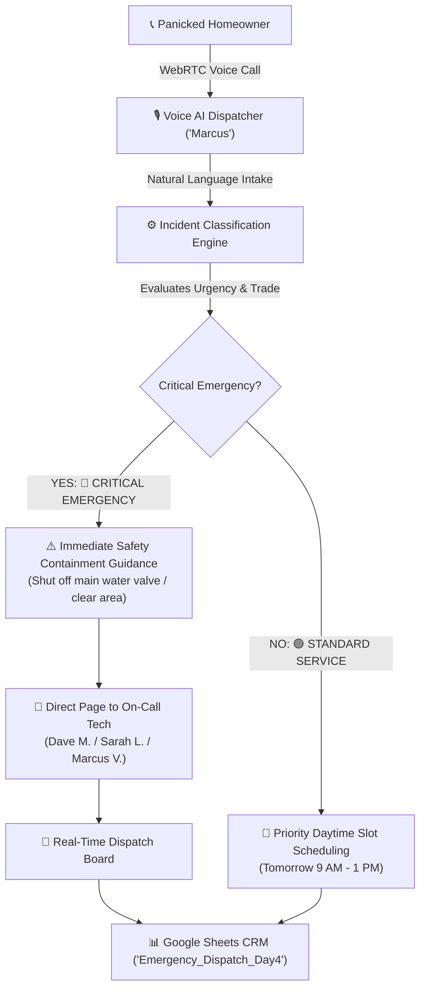

# 🚨 Day 04: Home Services Emergency Dispatch Voicebot (Plumbing, HVAC & Electrical)

> **Autonomous 24/7 Voice AI Dispatcher that triages high-ticket emergencies, issues real-time property containment instructions, pages on-call technicians, and logs work orders to Google Sheets in under 60 seconds.**

---

## 📌 Executive Summary & Client ROI

### The \$3,000 Emergency Missed Call
In high-ticket residential and commercial home services (plumbers, HVAC specialists, restoration contractors, and electricians):
* **40% of critical emergencies occur after-hours** (nights, weekends, holidays).
* A single burst water pipe, sewer backup, or mid-winter furnace breakdown represents a **\$1,500 to \$5,000+ emergency invoice**.
* When panicked homeowners reach a voicemail box at 11:00 PM, **82% hang up within 8 seconds** and call the next contractor on Google.
* **The Technician Burnout Dilemma:** On-call technicians refuse to be woken up at 2:00 AM for non-emergency inquiries (e.g. routine faucet drips or quote requests).

### The Solution: Apex 24/7 Voice AI Dispatcher
An autonomous voice coordinator ("Marcus") that delivers:
1. **Zero-Voicemail Answering (<1 Second):** Answers every inbound call 24/7/365 with professional, authoritative empathy.
2. **Two-Tier Incident Triage:**
   * **🔴 TIER 1 — CRITICAL EMERGENCY:** Immediately gives property containment safety advice (e.g. water shutoff valve, electrical hazard warning), pages the on-call truck, and issues a 25–40 minute arrival dispatch.
   * **🟢 TIER 2 — STANDARD SERVICE:** Reassures the caller and schedules a priority daytime appointment window without disturbing on-call staff.
3. **Dual-Write Operations Sync:** Writes tickets in real time to the live **Operations Dispatch Board** and logs records to the clinic/business **Google Sheets CRM (`Emergency_Dispatch_Day4`)**.

---

## 🏗️ System Architecture & Data Flow



---

## ✨ Core Engineering Capabilities

1. **Trade-Specific Clinical Triage:**
   * Detects plumbing, HVAC, and electrical issues automatically from natural speech.
2. **Life & Property Containment Advice:**
   * Directs homeowners to shut off main water supply valves for leaks or clear away from electrical hazards while trucks are in transit.
3. **Live Web Operations Console:**
   * Real-time dispatch board showing technician assignment, incident notes, customer address, ETA, and priority badges.
4. **Google Sheets CRM Sync:**
   * Direct RS256 JWT service-account integration appending structured rows directly to tab `Emergency_Dispatch_Day4`.
5. **Microphone Level Visualizer & Echo Cancellation:**
   * Live Web Audio API `AudioContext` equalizer and auto-muting during dispatcher speech.

---

## 📊 Google Sheets CRM Schema (`Emergency_Dispatch_Day4`)

| Column | Field Name | Description | Example |
| :---: | :--- | :--- | :--- |
| **A** | `TIMESTAMP` | ISO / Local Timestamp | `10/26/2026, 5:25:10 PM` |
| **B** | `TICKET ID` | Unique Ticket Number | `APX-EMG-101` |
| **C** | `HOMEOWNER NAME` | Full Customer Name | `Robert Vance` |
| **D** | `PHONE NUMBER` | Direct Callback Number | `03471098310` |
| **E** | `SERVICE ADDRESS` | Service Location | `452 Maple Creek Drive, Suite 4` |
| **F** | `INCIDENT / ISSUE` | Reported Problem | `Burst pipe flooding finished basement` |
| **G** | `URGENCY PRIORITY` | Triage Classification | `🔴 CRITICAL EMERGENCY` |
| **H** | `ASSIGNED TECHNICIAN` | On-Call Specialist | `Dave Miller (Master Plumber #4)` |
| **I** | `DISPATCH STATUS` | Current Status | `🚨 DISPATCHED` |
| **J** | `SAFETY INSTRUCTION` | Containment Advice Given | `Instructed to shut off main water valve` |

---

## 🚀 Quickstart & Running Locally

### 1. Start the Dispatch Server
```bash
cd day-04-emergency-dispatch-voicebot
node server.js
```

### 2. Access the Operations Console
Open your browser to:
```
http://localhost:3004
```

### 3. Voice Call Demo
Click **📞** and test either scenario:
* **Emergency Scenario:** *"Our basement is flooding from a broken pipe!"*
* **Standard Scenario:** *"I want to book an annual AC checkup."*
