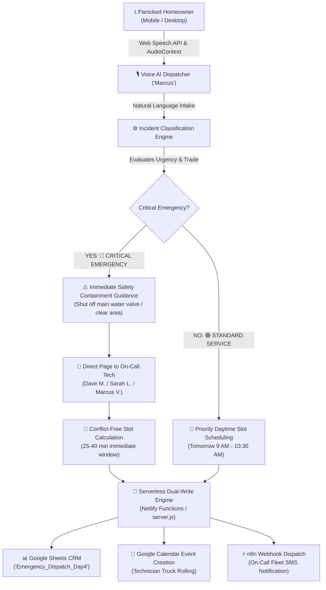

# 🚨 Day 04: Home Services Emergency Dispatch Voicebot (Plumbing, HVAC & Electrical)

> **Autonomous 24/7 Voice AI Dispatcher that triages high-ticket emergencies, issues real-time property containment instructions, allocates conflict-free technician arrival windows, and logs work orders to Google Sheets and Google Calendar in under 60 seconds.**

[](https://apex-emergency-dispatch.netlify.app)
[](https://calendar.google.com)
[](https://sheets.google.com)

---

## 🌐 Live Production URL
* **Production Web App:** [https://apex-emergency-dispatch.netlify.app](https://apex-emergency-dispatch.netlify.app)
* **Mobile Ready:** 100% responsive across mobile, tablet, and desktop (no horizontal scroll).

---

## 📌 Executive Summary & Client ROI

### The $3,000 Emergency Missed Call
In high-ticket residential and commercial home services (plumbers, HVAC specialists, restoration contractors, and electricians):
* **40% of critical emergencies occur after-hours** (nights, weekends, holidays).
* A single burst water pipe, sewer backup, or mid-winter furnace breakdown represents a **$1,500 to $5,000+ emergency invoice**.
* When panicked homeowners reach a voicemail box at 11:00 PM, **82% hang up within 8 seconds** and call the next contractor on Google.
* **The Technician Burnout Dilemma:** On-call technicians refuse to be woken up at 2:00 AM for non-emergency inquiries (e.g. routine faucet drips or quote requests).

### The Solution: Apex 24/7 Voice AI Dispatcher
An autonomous voice coordinator ("Marcus") that delivers:
1. **Zero-Voicemail Answering (<1 Second):** Answers every inbound call 24/7/365 with professional, authoritative empathy.
2. **Two-Tier Incident Triage:**
   * **🔴 TIER 1 — CRITICAL EMERGENCY:** Immediately gives property containment safety advice (e.g. water shutoff valve, electrical hazard warning), pages the on-call truck, and issues a 25–40 minute arrival dispatch.
   * **🟢 TIER 2 — STANDARD SERVICE:** Reassures the caller and schedules a priority daytime appointment window without disturbing on-call staff.
3. **Conflict-Free Arrival Window Allocation:** Cross-checks active technicians against existing Google Calendar events and assigns the next open slot.
4. **Serverless Dual-Write Operations Sync:** Writes tickets in real time to the live **Operations Dispatch Board**, appends records to **Google Sheets CRM (`Emergency_Dispatch_Day4`)**, and schedules dispatches in **Google Calendar**.

---

## 🏗️ System Architecture & Data Flow



---

## ✨ Core Engineering Capabilities

1. **Trade-Specific Triage:**
   * Detects plumbing, HVAC, and electrical emergencies automatically from spoken or typed input.
2. **Life & Property Containment Advice:**
   * Directs homeowners to shut off main water valves for leaks or clear away from electrical hazards while trucks are in transit.
3. **Conflict-Free Calendar Scheduling Engine:**
   * Prevents double-booking by verifying active dispatches and finding the next available slot automatically.
4. **Mobile & Cross-Platform Voice Hardening:**
   * 0ms instant start delay, cross-platform baritone male voice (`pitch: 0.68`), 1000ms silence debounce for mobile interim transcripts, and tactile push-to-talk controls.
5. **Serverless Netlify Function (`api.js`):**
   * Direct RS256 JWT Google Service Account authentication to write directly to Google Sheets and Google Calendar.
6. **Live Interactive Operations Board:**
   * Real-time dispatch board showing technician assignment, incident notes, customer address, ETA, and priority badges.

---

## 📊 Google Sheets CRM Schema (`Emergency_Dispatch_Day4`)

| Column | Field Name | Description | Example |
| :---: | :--- | :--- | :--- |
| **A** | `TIMESTAMP` | ISO / Local Timestamp | `10/27/2026, 11:29:43 AM` |
| **B** | `TICKET ID` | Unique Ticket Number | `APX-EMG-101` |
| **C** | `HOMEOWNER NAME` | Full Customer Name | `Rehan Zia` |
| **D** | `PHONE NUMBER` | Direct Callback Number | `03471098310` |
| **E** | `SERVICE ADDRESS` | Service Location | `542 Green Avenue Apt 3` |
| **F** | `INCIDENT / ISSUE` | Reported Problem | `Plumbing leak flooded kitchen floor` |
| **G** | `URGENCY PRIORITY` | Triage Classification | `🔴 CRITICAL EMERGENCY` |
| **H** | `ASSIGNED TECHNICIAN` | On-Call Specialist | `Dave Miller (Master Plumber #4)` |
| **I** | `DISPATCH STATUS` | Current Status | `🚨 DISPATCHED` |
| **J** | `SAFETY INSTRUCTION` | Containment Advice Given | `Homeowner instructed to shut off water valve` |

---

## 🚀 Quickstart & Running Locally

### 1. Install & Start Server
```bash
cd day-04-emergency-dispatch-voicebot
npm install
node server.js
```

### 2. Access the Operations Console
Open your browser to:
```
http://localhost:3004
```

### 3. Voice Call Demo
Click **📞** and test either scenario:
* **Emergency Scenario:** *"Our basement is flooding from a broken pipe!"*
* **Standard Scenario:** *"I want to book an annual AC checkup."*

---

## 👤 Author & Deployment
**Muhammad Rehan**  
Founder & Voice AI Specialist  
* **LinkedIn:** [linkedin.com/in/rehan-zia-voiceai](https://www.linkedin.com/in/rehan-zia-voiceai/)  
* **Live App:** [https://apex-emergency-dispatch.netlify.app](https://apex-emergency-dispatch.netlify.app)
