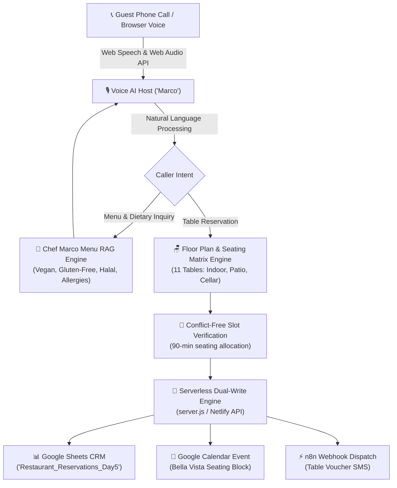

# 🍝 Day 05: Restaurant Table Reservation & Menu Q&A Voice Agent (Bella Vista Bistro)

> **Autonomous 24/7 Voice AI Maître d' ("Marco") that handles peak-hour phone orders, books conflict-free table reservations across a visual seating floor plan, answers dietary & menu FAQs (Vegan, Gluten-Free, Allergies), and synchronizes directly with Google Sheets CRM and Google Calendar in under 60 seconds.**

[](http://localhost:3005)
[](https://calendar.google.com)
[](https://sheets.google.com)

---

## 📌 Executive Summary & Hospitality ROI

### The $100,000 Dinner Rush Missed-Call Problem
In upscale and fast-casual hospitality:
* **28% of incoming phone reservations go unanswered** during the chaotic 6:00 PM – 9:00 PM dinner rush while hostesses and floor managers are actively seating guests.
* A single missed party of 4 represents an average loss of **$120 to $200+** in food, wine, and dessert revenue.
* Homeowners and corporate event organizers call the next Italian restaurant on Google when they reach a busy signal or voicemail.
* **The Dietary Screening Bottleneck:** Guests calling with celiac disease, severe nut allergies, or vegan preferences take 4–6 minutes of host time over the phone during peak service.

### The Solution: Bella Vista Voice AI Host ("Marco")
An autonomous, warm, and sophisticated Voice AI host delivering:
1. **Zero-Voicemail Answering (<1 Second):** Picks up every call instantly with warm Italian hospitality.
2. **Interactive Menu RAG Engine:** Instantly answers complex questions on gluten-free pasta substitutions, vegan truffle risotto, Halal meats, peanut-free kitchen protocols, operating hours, and complimentary valet parking.
3. **Conflict-Free Seating Matrix:** Automatically allocates 11 distinct restaurant tables (Indoor Window 2-tops, Main Dining family booths, Garden Patio fairy-light tables, and Private Wine Cellar Suites for up to 14 guests) with 90-minute seating blocks.
4. **Serverless Dual-Write Operations Sync:**
   * Writes confirmed bookings directly to **Google Sheets CRM (`Restaurant_Reservations_Day5`)**.
   * Creates calendar reservation events in **Google Calendar** with party size and table notes.
   * Dispatches live webhook alerts to **n8n** for customer SMS vouchers.

---

## 🏗️ System Architecture & Data Flow



---

## 🪑 Restaurant Table Seating Inventory

| Table ID | Table Name | Seating Area | Capacity | Ambience & Description |
| :---: | :--- | :--- | :---: | :--- |
| **T1** | Table 1 | Indoor Window | 2 Guests | Quiet romantic 2-top by garden window |
| **T2** | Table 2 | Indoor Main | 2 Guests | Intimate candlelit dining |
| **T3** | Table 3 | Indoor Main | 4 Guests | Prime center dining banquette |
| **T4** | Table 4 | Indoor Main | 4 Guests | Spacious family dining table |
| **T5** | Table 5 | Indoor Main | 6 Guests | Luxurious leather booth |
| **T6** | Table 6 | Indoor Main | 8 Guests | Large executive banquet table |
| **P1** | Patio P1 | Garden Patio | 2 Guests | Pergola fairy-light bistro table |
| **P2** | Patio P2 | Garden Patio | 2 Guests | Fountain-side romantic 2-top |
| **P3** | Patio P3 | Garden Patio | 4 Guests | Heated open-air terrace table |
| **P4** | Patio P4 | Garden Patio | 4 Guests | Sunset garden view terrace |
| **PR1** | Wine Cellar Suite | Private Dining | 14 Guests | Exclusive private dining wine cellar |

---

## 📊 Google Sheets CRM Schema (`Restaurant_Reservations_Day5`)

| Column | Field Name | Description | Example |
| :---: | :--- | :--- | :--- |
| **A** | `TIMESTAMP` | Booking Creation Time | `10/27/2026, 11:54:19 AM` |
| **B** | `RESERVATION ID` | Unique Confirmation Code | `BV-RES-201` |
| **C** | `GUEST NAME` | Full Customer Name | `Rehan Zia` |
| **D** | `PHONE NUMBER` | Callback / SMS Number | `03471098310` |
| **E** | `DATE & TIME` | Dining Schedule | `Tue, Oct 27, 7:30 PM` |
| **F** | `PARTY SIZE` | Number of Guests | `4 Guests` |
| **G** | `SEATING PREFERENCE` | Preferred Location | `Garden Patio` |
| **H** | `DIETARY & OCCASION` | Special Requests / Allergy | `Anniversary celebration, heated terrace` |
| **I** | `TABLE ASSIGNED` | Allocated Table | `Patio P4 (Garden Patio)` |
| **J** | `STATUS` | Reservation Status | `CONFIRMED` |

---

## 🚀 Quickstart & Running Locally

### 1. Install & Run Server
```bash
cd day-05-restaurant-reservation-voicebot
npm install
node server.js
```

### 2. Access the Operations Console
Open your browser to:
```
http://localhost:3005
```

### 3. Voice Call Demo
Click **📞** and test with any of the 4 demo scenarios:
* **Table for 4:** *"I'd like to reserve a table for 4 guests tonight at 7:30 PM."*
* **Dietary Q&A:** *"Do you have vegan and gluten-free pasta options?"*
* **Patio Anniversary:** *"We are celebrating our wedding anniversary tonight and want a candlelit patio table."*
* **Valet & Hours:** *"Do you offer valet parking, and what are your operating hours?"*

---

## 👤 Author
**Muhammad Rehan**  
Founder & Voice AI Specialist  
* **LinkedIn:** [linkedin.com/in/rehan-zia-voiceai](https://www.linkedin.com/in/rehan-zia-voiceai/)  
* **Portfolio:** [rehanziadeveloper-ship-it/My-Projects](https://github.com/rehanziadeveloper-ship-it/My-Projects)
