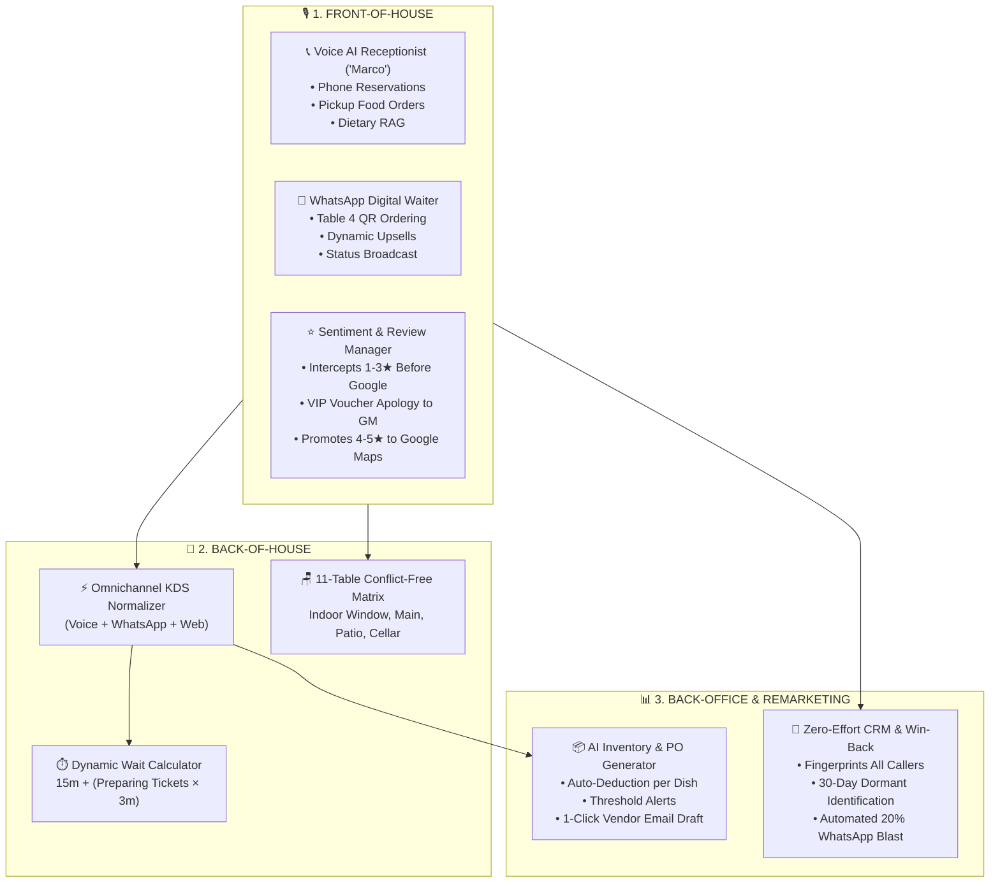

# 🍝 Day 05: Bella Vista Bistro — Autonomous AI Restaurant Ecosystem

> **Full-Stack Autonomous Restaurant Operations & Voice AI Platform featuring 3 Core Pillars: Front-of-House (Voice AI Receptionist + WhatsApp Digital Waiter + Review Interception), Back-of-House (Omnichannel KDS + Dynamic Wait Times + 11-Table Matrix), and Back-Office (AI Inventory & Predictive Purchasing + CRM 30-Day Win-Back Remarketing). Engineered with dual-market adaptability for Western POS & Pakistani Cash-on-Delivery markets.**

[](http://localhost:3005)
[](https://calendar.google.com)
[](https://sheets.google.com)
[](http://localhost:3005)

---

## 📌 Executive Summary & Architecture Overview

Hospitality venues lose upwards of **28% of incoming customer calls** during peak dinner hours (6:00 PM – 9:00 PM), drop orders due to chaotic multi-channel entry points, and suffer margin losses from un-intercepted negative public reviews and dormant guests.

This Day 5 system transforms the restaurant into an **autonomous, self-directing hospitality ecosystem**:



---

## 🏛️ The Three Architectural Pillars

### 1. Front-of-House: Customer Interaction & Ordering
* **Voice AI Receptionist & Order Taker ("Marco"):**
  * Built on Web Speech API with pitch-tuned warm Italian baritone register (`0.72` pitch).
  * Takes both **table reservations** across 11 tables and **food pickup orders** with dynamic wait time updates.
  * Deep dietary RAG engine: Answers questions on Celiac/gluten-free substitutions, vegan risotto, Halal meats, peanut-free kitchen protocols, and valet parking.
  * Full mobile resilience: 1000ms silence debounce on speech recognition + buffer flush so mobile speech is never dropped.
* **WhatsApp Automation ("The Digital Waiter"):**
  * Instant QR-code ordering for seated guests (e.g. Table 4).
  * Interactive recommendation and upselling engine (*"Would you like extra Truffle Parmesan Fries (+$6) or an Italian Limoncello Spritz (+$10)?"*).
  * Dispatches tickets straight into the Kitchen Display System (KDS).
* **Automated Review & Sentiment Management:**
  * Post-dining feedback interceptor.
  * **1–3 Star Negative Feedback:** Intercepted **before** reaching Google Maps, dispatches urgent alert to the General Manager, and delivers an automated 25% VIP apology voucher.
  * **4–5 Star Promoters:** Guided to Google Maps review page with pre-drafted gratitude response.

### 2. Back-of-House: Kitchen & Order Sync
* **Omnichannel Order Consolidation (KDS):**
  * Unifies tickets from Voice AI, WhatsApp Digital Waiter, and Web into a single live visual ticket board.
  * Interactive status toggles: `[🍳 PREPARING]` ➔ `[✅ READY FOR PLATING]` ➔ `[📦 COMPLETED]`.
* **Dynamic Wait Time Calculation:**
  * Formula: `Base 15 Mins + (Active PREPARING Tickets × 3 Mins)`.
  * Communicated in real time to both voice callers and WhatsApp diners so expectations are managed accurately.
* **11-Table Seating Floor Plan Matrix:**
  * 11 distinct zones: Indoor Window 2-tops, Main Dining family booths, Garden Patio fairy-light tables, and Private Wine Cellar Suites (up to 14 guests).

### 3. Back-Office: Admin, Inventory & Remarketing
* **AI Inventory & Predictive Purchasing:**
  * Real-time ingredient tracking (San Marzano Tomatoes, Carnaroli Rice, White Truffle Oil, Fior di Latte Mozzarella).
  * Auto-decrementing stock upon order submission.
  * Predictive Purchase Order (PO) drafting: Generates pre-formatted supplier email for low-stock items with quantities, pricing, and required delivery window.
* **Zero-Effort CRM & 30-Day Win-Back Remarketing:**
  * Automatically profiles every phone caller and WhatsApp guest (lifetime spend, total orders, last visit date).
  * Segments diners into *VIP Diners* vs *Dormant (>30 Days)*.
  * One-Click **30-Day Win-Back WhatsApp Broadcast**: Dispatches personalized 20% discount code `WELCOMEBACK20` to re-engage past customers.

---

## 🌍 Dual-Market Adaptability Engine

| Dimension | 🇺🇸 Western Market Mode (US / UK / EU) | 🇵🇰 Pakistani Market Mode (Pakistan) |
| :--- | :--- | :--- |
| **Primary Channel** | Voice AI Front Desk + POS Direct Sync | WhatsApp-First ("WATI" Style) Digital Experience |
| **Language Nuance** | Polite English / Hospitality Maître d' | Roman Urdu / Minglish (*"G bilkul", "shukriya", "bhai"*) |
| **POS & Kitchen** | Toast / Square POS REST API Integration | Kitchen Display System + WhatsApp Kitchen Alerts |
| **Payment Workflow**| Voice Pre-Authorized Credit Card Checkout | **Automated Cash-on-Delivery (COD) Phone Verification** |
| **Dietary Focus** | Gluten-Free, Celiac, Vegan, Nut-Free | 100% Certified Halal, Zero-Pork, Zero-Alcohol kitchen |
| **Agency Pitch** | Hostess Labor Cost Reduction ($18+/hr saved) | WhatsApp Order Automation + Elimination of Fake COD Orders |

---

## 📊 5 Synchronized Google Sheets Tabs

Spreadsheet ID: `1Rpb9XQsymoDDSEl0n1EChgi8KY7BgmajFXctwreAMjo`

1. `Restaurant_Reservations_Day5`: Reservation ID, Guest Name, Phone, Dining Time, Party Size, Table Assigned, Status.
2. `Restaurant_Orders_Day5`: Order ID, Channel (Voice AI / WhatsApp), Guest, Phone, Items, Total Amount, Payment Method, Status, Wait Time.
3. `Restaurant_Inventory_Day5`: SKU, Ingredient Name, Current Stock, Unit, Reorder Threshold, Unit Cost, Status.
4. `Restaurant_CRM_Day5`: Customer ID, Name, Phone, Total Orders, Lifetime Spend, Last Order Date, Segment, Remarketing Status.
5. `Restaurant_Reviews_Day5`: Timestamp, Customer Name, Star Rating, Feedback Text, Sentiment, Interception Action, AI Response Draft.

---

## 🚀 Running Locally & Verification

```bash
# 1. Navigate to directory
cd d:/AI_ASSISANT/day-05-restaurant-reservation-voicebot

# 2. Start server
node server.js
```
Open `http://localhost:3005` in your browser. All tabs (Front-of-House, Back-of-House, Back-Office) are fully operational and synchronized.
