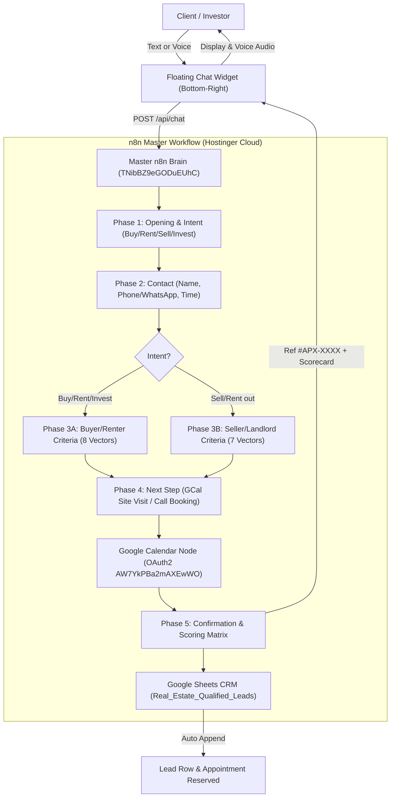

# 🏛️ Apex Realty AI — Pro-Level Virtual Assistant & Inbound Qualification

> **Pro-Level Real Estate Advisory System powered 100% by a master n8n workflow. Features a sleek floating chat widget, hands-free Web Speech API voice input/output, a strict 5-Phase Slot-Filling State Machine, automated Google Calendar appointment booking, and Google Sheets CRM sync.**

[](https://apex-realty-ai.netlify.app)
[](http://localhost:3006)
[](https://docs.google.com/spreadsheets/d/1Rpb9XQsymoDDSEl0n1EChgi8KY7BgmajFXctwreAMjo)
[](https://n8n.srv1767318.hstgr.cloud)

---

## 📌 Architecture Overview

Apex Realty AI eliminates repetitive screening calls by moving 100% of intelligence into a master n8n workflow while providing an ultra-lightweight, luxurious floating chat widget on the frontend.



---

## 🌟 Key Features

### 1. Frontend Redesign (Floating Chat Widget)
- **Default State:** Discreet circular floating bubble icon fixed in the bottom-right corner. Zero screen obstruction.
- **Open State:** Smoothly expands into a compact (380px wide), dark obsidian & gold glassmorphic window.
- **Voice Integration:** Integrated Push-to-Talk microphone powered by the Web Speech API with pulsing ring animation and hands-free spoken audio responses.
- **Dumb UI:** Frontend contains 0% scoring or business logic; it strictly sends payloads to the n8n webhook and displays n8n's responses.

### 2. The 5-Phase Slot-Filling State Machine
- **Strict 1-Question Rule:** The assistant asks only ONE missing question at a time. If the user provides multiple pieces of information in a single message, the state machine extracts all of them and skips redundant questions.
- **Phase 1: Opening & Intent:** Greet and extract Intent (`Buy`, `Rent`, `Sell`, `Rent out`, `Invest`).
- **Phase 2: Contact Details:** Safe name parsing, phone/WhatsApp number, optional email, and preferred contact method/time.
- **Phase 3A: Buyer/Renter Branch:** Purpose (Living vs Investment), Property Type, Location, Target Budget, Bedrooms, Payment Method (Cash vs Mortgage), Timeline, Must-Have Amenities.
- **Phase 3B: Seller/Landlord Branch:** Property Type, Location, Size & Condition, Asking Price, Document Readiness (Title deed in hand vs mortgaged), Occupancy Status (Vacant vs Occupied), Timeline.
- **Phase 4: Next Step (Google Calendar Booking):** Prompts for preferred appointment time ("Tomorrow at 3:00 PM for a site visit"), converts to ISO 8601 interval, and automatically reserves the event on Google Calendar.
- **Phase 5: Confirmation & Storage:** Summarizes all extracted vectors for user verification ("Is everything correct?"). Upon confirmation, calculates Lead Score (0–100), generates Reference ID (`#APX-XXXX`), and appends the structured profile to Google Sheets CRM.

### 3. Broker CRM Hub (Password: `broker123`)
- Secured broker portal fetching live leads exclusively via n8n `GET` webhook (`/api/leads`).
- Displays live pipeline metrics (Total Leads, Hot Leads &ge; 80 pts, Warm Leads).

---

## 🗄️ Database Architecture (Google Sheets)

Spreadsheet ID: `1Rpb9XQsymoDDSEl0n1EChgi8KY7BgmajFXctwreAMjo`  
Active Tab: `Real_Estate_Qualified_Leads`

| Column | Header | Description |
| :---: | :--- | :--- |
| **A** | `Lead_ID` | Reference ID (e.g. `#APX-2547`) |
| **B** | `Timestamp` | Inbound qualification timestamp |
| **C** | `Full_Name` | Client full name |
| **D** | `Phone` | Direct phone / WhatsApp number |
| **E** | `Email` | Client email address |
| **F** | `Property_Interest` | Property type & target location |
| **G** | `Budget_Range` | Clean budget or asking price |
| **H** | `Financing_Status` | Verified proof of funds / clean title |
| **I** | `Purchase_Timeline` | Closing / listing timeline |
| **J** | `Buyer_Type` | Intent, purpose & scheduled appointment |
| **K** | `Lead_Score` | 0 to 100 calculated score |
| **L** | `Lead_Tier` | `HOT` 🔥, `WARM` ⚡, `COLD` ❄️ |
| **M** | `Recommended_Action` | Managing broker prescribed action |
| **N** | `Status` | `NEW`, `ASSIGNED`, `SHOWING SCHEDULED` |

---

## ⚡ Active n8n Workflow Endpoints

- **Workflow Name:** `Day 6 - Apex Realty Master Brain (Pro-Level Backend)`
- **Workflow ID:** `TNibBZ9eGODuEUhC`
- **Inbound Chat Webhook:** `POST https://n8n.srv1767318.hstgr.cloud/webhook/apex-buyer-chat`
- **CRM Leads Webhook:** `GET https://n8n.srv1767318.hstgr.cloud/webhook/apex-crm-leads`
- **Listings Webhook:** `GET https://n8n.srv1767318.hstgr.cloud/webhook/apex-listings`
- **Google Calendar Credential:** `AW7YkPBa2mAXEwWO`
- **Google Sheets Credential:** `AqyKDLuwANoDYrEw`

---

## 🚀 Running Locally

```bash
cd day-06-real-estate-buyer-qualification
node server.js
```

Open [`http://localhost:3006`](http://localhost:3006) in your browser.  
Broker CRM Password: `broker123`
