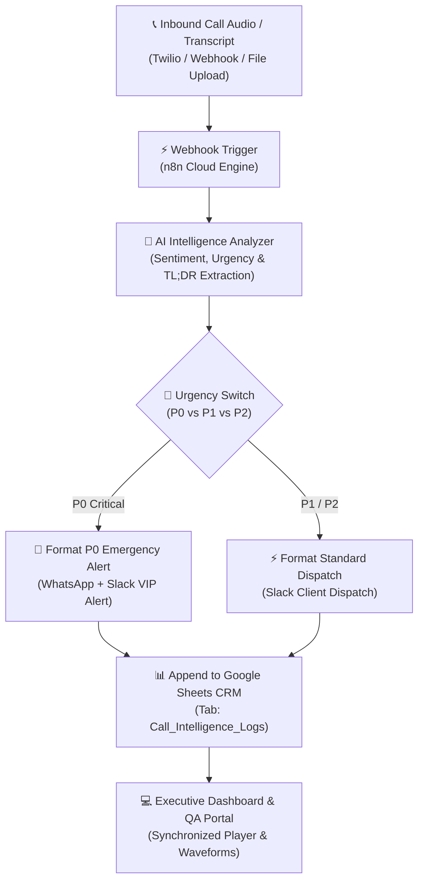

# Day 7: Post-Call Intelligence & Sentiment Analysis Pipeline

> **Autonomous Audio Summarizer, Sentiment Vector Engine & Sub-15s Speed-to-Lead Executive Dispatch Hub**  
> Built for High-Stakes Inbound Calls: Luxury Real Estate, Dental & Medical Emergencies, and VIP Hospitality Buyouts.

---

## ⚡ Executive Summary
The primary bottleneck in enterprise voice automation is the **"Black-Box Trust Gap"**:
Business owners and managing brokers **do not have time to listen to 5-minute call recordings** or read messy 50-line transcripts. When high-ticket clients call late at night or with acute emergencies, delayed callbacks kill conversion rates.

**PulseAI (Day 7)** solves this by executing an autonomous post-call intelligence pipeline:
1. **Ultra-Fast Ingestion:** Ingests raw call audio / transcript text via Webhooks.
2. **Multi-Vector Intelligence Extraction:** Extracts 0–100 Sentiment score, Urgency level (`P0 Critical`, `P1 High`, `P2 Routine`), an **Executive 3-Bullet TL;DR**, actionable tasks with assigned staff members and deadlines, and friction/objection flags.
3. **Sub-15s Speed-to-Lead Dispatch:** Instantly pushes formatted intelligence cards to the owner's WhatsApp and Slack.
4. **Clean Multi-Column CRM Database:** Logs every analyzed call into Google Sheets tab `Call_Intelligence_Logs` with strict 12-column schema.

---

## 🛠️ Architecture & Tech Stack



* **Orchestration:** n8n Cloud Master Workflow (`xMLcBqAKsKtHR7fq` on Hostinger)
* **Frontend:** Interactive Command Center (Tailwind CSS, Lucide Icons, Plus Jakarta Sans, Cinzel)
* **Database / CRM:** Google Sheets API (`Call_Intelligence_Logs` tab with exact 12 columns)
* **Hosting:** Netlify Serverless Functions & Local Node.js (Port 3007)

---

## 📊 Google Sheets CRM Schema (`Call_Intelligence_Logs`)

| Column | Header | Description |
| :--- | :--- | :--- |
| **A** | `Call_ID` | Unique identifier (e.g., `CALL-701`) |
| **B** | `Date_Time` | ISO timestamp of analysis |
| **C** | `Caller_Name` | Client or patient full name |
| **D** | `Phone_Number` | E.164 phone with safe leading quote (`+1 (310) 555-8910`) |
| **E** | `Call_Type` | Real Estate Lead / Dental Emergency / Restaurant Buyout |
| **F** | `Duration` | Total call length (e.g. `3m 42s`) |
| **G** | `Urgency_Level` | `P0 - CRITICAL (<15 min)` / `P1 - HIGH (<2 hr)` / `P2 - ROUTINE` |
| **H** | `Sentiment` | `Highly Enthusiastic`, `Positive`, `Frustrated & Distressed` |
| **I** | `Sentiment_Score` | Numeric rating (-100 to +100) |
| **J** | `Executive_Summary_TLDR` | Strictly 3 high-impact executive bullets |
| **K** | `Action_Items` | Concrete operational tasks with assigned staff and deadlines |
| **L** | `Key_Objections_or_Risks` | Customer friction points and constraints identified |

---

## 🎯 Pre-Loaded High-Stakes Demo Scenarios

1. **CALL-701: Harrison Vance ($4.5M Bel-Air Penthouse)**
   * *Profile:* All-cash buyer verified with Morgan Stanley Private Wealth. Flying to London Friday evening—requires private walkthrough tomorrow at 2:00 PM.
   * *Urgency:* `P0 - CRITICAL (<15 min)` | *Sentiment:* `Highly Enthusiastic (+98)`
2. **CALL-702: Marcus Brody (Cracked Molar Agony)**
   * *Profile:* Patient in acute pain from cracked lower right molar with root exposed. Dissatisfied with regular dentist's unanswered voicemail. Needs immediate same-day surgical slot.
   * *Urgency:* `P0 - CRITICAL (<15 min)` | *Sentiment:* `Frustrated & Distressed (-100)`
3. **CALL-703: Elena Rostova (45-Guest Gala Buyout)**
   * *Profile:* Corporate buyout of mezzanine for 45 C-suite executives ($15,000 budget; $12,500 minimum spend). Requires acoustic sound isolation and 4 vegan/GF tasting menus.
   * *Urgency:* `P1 - HIGH (<2 hr)` | *Sentiment:* `Positive / Satisfied (+58)`

---

## 🚀 Running Locally

```bash
cd d:\AI_ASSISANT\day-07-post-call-intelligence
node server.js
```
Open [http://localhost:3007](http://localhost:3007) in your browser.
